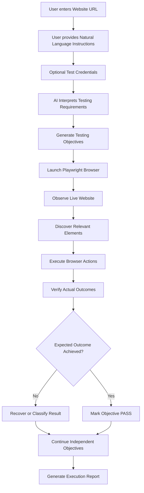
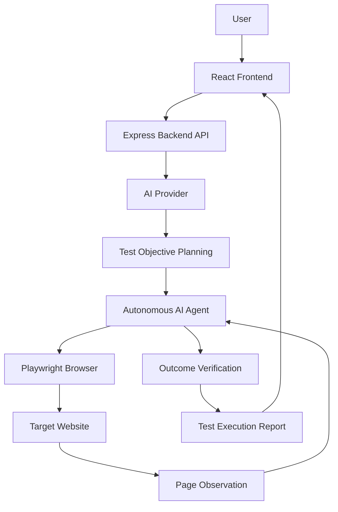

# TestIT 
### AI-Powered Autonomous Website Testing

**TestIT** is an AI-powered website testing platform that allows anyone to test a website using simple natural-language instructions. Instead of manually writing test scripts or defining selectors, users provide a website URL, describe what they want to test, and let an AI agent explore, interact with, and verify the website.

> **Describe the test. Let AI execute it. Verify the results.**

---

## Table of Contents

- [Overview](#-overview)
- [Problem Statement](#-problem-statement)
- [Our Solution](#-our-solution)
- [Key Features](#-key-features)
- [How It Works](#-how-it-works)
- [Technology Stack](#-technology-stack)
- [System Architecture](#-system-architecture)
- [Getting Started](#-getting-started)
- [Environment Variables](#-environment-variables)
- [API Endpoints](#-api-endpoints)
- [Security Considerations](#-security-considerations)
- [Future Scope](#-future-scope)
- [Contributing](#-contributing)

---

## Overview

Website testing is an essential part of software development, but traditional testing often requires technical knowledge, predefined test cases, and repetitive manual effort.

TestIT aims to simplify this process through autonomous AI-driven testing.

Users can:
1. Enter the URL of a website.
2. Describe the testing requirements in plain English.
3. Optionally provide authorized test credentials.
4. Start an autonomous testing session.
5. Receive a structured execution report with results and evidence.

TestIT uses AI to interpret instructions, dynamically explore websites, identify interactive elements, perform actions through browser automation, and verify whether the expected outcomes actually occur.

---

## Problem Statement

Traditional website testing comes with several challenges:

- **Repetitive manual testing:** Developers and testers repeatedly perform the same workflows.
- **Technical dependency:** Writing automated test scripts requires knowledge of tools such as Playwright or Selenium.
- **Rigid test cases:** Traditional automation often depends on predefined selectors and fixed workflows.
- **Limited adaptability:** Changes in website layouts can break existing test scripts.
- **Unreliable verification:** Performing an action does not necessarily mean the expected result occurred.

These challenges make testing time-consuming and less accessible to non-technical users.

---

## Our Solution

TestIT introduces an AI-powered autonomous testing agent that understands testing requirements written in natural language.

Rather than relying on fixed website-specific scripts, the agent observes the website, identifies relevant elements, determines the next action, executes it, and checks the resulting state.

The platform is designed to work across different categories of websites, including:

- E-commerce platforms
- Educational websites
- Booking platforms
- Authentication systems
- Dashboards and web applications
- Other interactive websites

The goal is to make website testing more accessible, flexible, and intelligent.

---

## Key Features

### 1. Natural Language Test Instructions
Describe testing requirements in plain English without writing test scripts or specifying CSS selectors.

### 2. AI-Powered Test Planning
The AI interprets user instructions and breaks them into smaller, actionable testing objectives.

### 3. Autonomous Browser Interaction
Uses Playwright to navigate websites, interact with forms, click buttons, select options, and perform other browser actions.

### 4. Dynamic Element Discovery
Observes the live webpage and identifies relevant interactive elements instead of depending on hardcoded website-specific selectors.

### 5. Authentication Support
Supports authenticated testing through user-provided test credentials when protected functionality requires login.

### 6. Outcome-Based Verification
Checks whether actions produce the expected results instead of treating a successful click as proof of success.

### 7. Adaptive Execution
Uses fresh page observations and contextual information to recover from certain interaction failures and adapt to changing page states.

### 8. Structured Test Reports
Provides execution statuses and details about completed, failed, blocked, skipped, or errored objectives.

### 9. Independent Objective Execution
Allows independent public testing objectives to continue even when an authentication-dependent objective is blocked.

---

## How It Works

TestIT follows an AI-driven testing workflow:



### Execution Workflow

1. **Input:** The user provides a website URL and testing instructions.
2. **Planning:** The AI converts the instructions into individual testing objectives.
3. **Observation:** The browser agent examines the current webpage and its available elements.
4. **Action:** Playwright executes the appropriate browser interactions.
5. **Verification:** The agent observes the resulting webpage state and checks whether the expected outcome occurred.
6. **Recovery:** When an interaction fails, the agent can re-observe the page and attempt context-aware recovery where appropriate.
7. **Reporting:** The platform generates a structured report containing execution statuses and available evidence.

---

## Technology Stack

| Category | Technologies |
|---|---|
| Frontend | React.js, Vite |
| Styling | CSS / Tailwind CSS |
| Backend | Node.js, Express.js |
| Browser Automation | Playwright |
| AI Integration | Gemini API, OpenAI API |
| API Communication | REST API |
| Deployment | Vercel, Render |
| Runtime Environment | Node.js, Docker |

---

## System Architecture

TestIT is divided into two primary components:

### Frontend
Responsible for:
- Website URL input.
- Natural-language testing instructions.
- Test credential input.
- Starting and monitoring test execution.
- Displaying execution results and reports.

### Backend
Responsible for:
- Receiving and validating test requests.
- AI-powered objective planning.
- Browser session management.
- Dynamic webpage observation.
- Playwright-based browser interaction.
- Authentication and session verification.
- Outcome verification and recovery.
- Generating structured execution reports.

### High-Level Architecture



---

## Getting Started

Follow these instructions to run TestIT locally.

### Prerequisites

Make sure you have installed:

- Node.js (compatible with the project dependencies)
- npm
- Git
- A supported AI provider API key
- A supported Playwright browser environment

### 1. Clone the Repository

```bash
git clone <YOUR_REPOSITORY_URL>
cd TestIT
```

### 2. Install Backend Dependencies

```bash
cd backend
npm install
```

### 3. Install Frontend Dependencies

Open another terminal:

```bash
cd frontend
npm install
```

### 4. Configure Environment Variables

Create a `.env` file inside the backend directory.

Add the environment variables required by your configured AI provider and backend application.

See [Environment Variables](#-environment-variables).

### 5. Start the Backend

From the project root:

```bash
npm --prefix backend run dev
```

If your backend uses a different development script, use the script defined in `backend/package.json`.

### 6. Start the Frontend

In another terminal:

```bash
npm --prefix frontend run dev
```

Open the local Vite URL displayed in your terminal, usually:

```text
http://localhost:5173
```

---

## Environment Variables

The backend requires configuration for the selected AI provider.

Example configuration:

```env
PORT=5001
FRONTEND_URL=http://localhost:5173

GEMINI_API_KEY=your_gemini_api_key

# Optional, if OpenAI is configured as an alternative provider
OPENAI_API_KEY=your_openai_api_key
```

**Important:**
- Use the environment variable names expected by your backend implementation.
- At least one supported AI provider must be configured.
- Do not commit `.env` files or expose API keys in the frontend.
- Configure production environment variables separately on your hosting provider.

The frontend uses the following environment variable for the backend API URL:

```env
VITE_API_BASE_URL=http://localhost:5001
```

For production, set it to your deployed backend URL.

---

## API Endpoints

| Method | Endpoint | Description |
|---|---|---|
| GET | `/api/health` | Checks backend health |
| POST | `/api/ai-tests/run` | Starts an AI-powered website testing session |

### Health Check

```http
GET /api/health
```

### Run AI Test

```http
POST /api/ai-tests/run
Content-Type: application/json
```

The request contains the target website URL, natural-language testing instructions, and optional test credentials.

The exact request and response schemas are defined by the backend implementation.

---

## Security Considerations

TestIT is designed with security in mind.

- Credentials should be supplied only by authorized users for legitimate testing.
- Passwords and other secrets should not be exposed in AI prompts or execution reports.
- Sensitive information should be redacted from logs.
- Browser navigation and network requests should be protected against unsafe destinations and SSRF.
- Website content must be treated as untrusted input.
- CAPTCHA, MFA, and identity verification mechanisms must not be bypassed.
- Destructive actions and real purchases should not be performed without explicit authorization.

---

## Future Scope

Potential improvements and extensions include:

- More advanced autonomous recovery and self-healing execution.
- Expanded support for complex multi-page user journeys.
- Richer visual and accessibility-based verification.
- Screenshot and video evidence for test execution.
- Historical test reports and execution comparisons.
- Test scheduling and recurring execution.
- Improved support for different authentication mechanisms.
- Team collaboration and shared test reports.
- More AI provider integrations.

---

## Contributing

Contributions, suggestions, and feedback are welcome!

If you would like to contribute:

1. Fork the repository.
2. Create a new feature branch.
3. Implement your changes.
4. Test your implementation.
5. Submit a pull request.

---

## Project Vision

TestIT aims to make autonomous website testing accessible to everyone.

The idea is simple: users should be able to explain what they want tested without needing to know how to write automation scripts.

**Building a website is only half the job. Making sure it actually works is the other half.**

---

**TestIT — Describe it. Test it. Verify it.**
